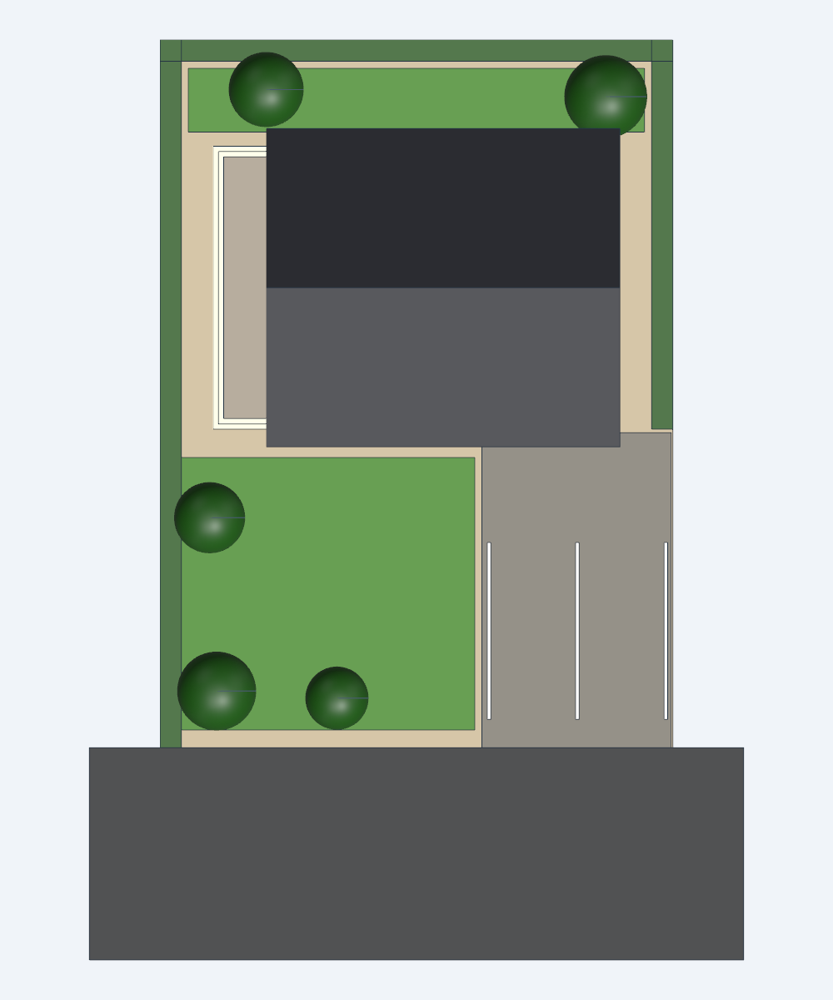
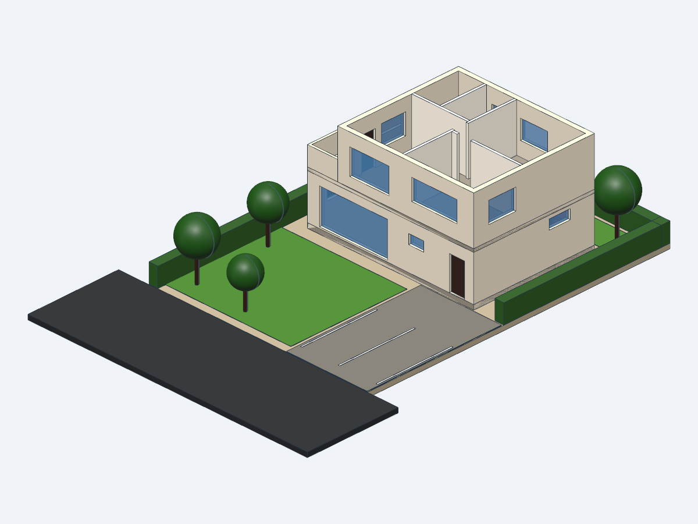

# 2층 단독주택 (경산4일반산업단지 단독주택용지, 경일대 인근)

text-to-cad(build123d)로 만든 대지 + 주택 3D 모델입니다.

| 외관 | 배치도 |
| --- | --- |
|  |  |
|  |  |

## 대지

- 위치: 경상북도 경산시 진량읍 신제리·다문리 일원, 경산4일반산업단지 단독주택용지 (경일대에서 가까운 신규 택지)
- 기준: 제1종일반주거지역, 건폐율 60 % 이하, 용적률 180 % 이하, 3층 이하, 단독주택·점포주택 허용
- 단독주택용지는 86필지, 총 약 25,000 ㎡로 필지 평균은 약 290 ㎡입니다.
- 필지 번호(지번)는 **미확정**입니다. 한국산업단지공단 분양 필지도에서 필지를 고르면 `house.py`의 `LOT_W`, `LOT_D`를 맞춥니다.
- 대지 형상은 평균 필지로 가정했습니다: 14.5 m(동서) × 20 m(남북) = 290 ㎡, 남측 6 m 도로.

## 건물 개요

- 철근콘크리트조 2층, 박공지붕(물매 1:2), 최고높이 8.50 m, 층고 3.0 m
- 1층 88 ㎡: 거실, 주방·식당, 현관, 화장실, 다용도실, 계단
- 2층 72 ㎡: 안방, 방2, 드레스룸, 욕실, 홀. 서측 1층 지붕 위에 테라스(난간 1.2 m)
- 주차 2대(2.5 × 5.0 m), 앞마당·북측 정원, 생울타리 1.2 m

## 법규 검토 (`check.py`)

| 항목 | 계획 | 기준 | 근거 |
| --- | --- | --- | --- |
| 건폐율 | 30.3 % | ≤ 60 % | 경산4산단 단독주택용지 기준 |
| 용적률 | 55.2 % | ≤ 180 % | 경산4산단 단독주택용지 기준 |
| 층수 | 2층 | 3층 이하 | 경산4산단 단독주택용지 기준 |
| 정북 일조 | 북측 경계에서 3.0 m | 높이 10 m 이하 부분 ≥ 1.5 m | 건축법 시행령 제86조 |
| 접도 | 6 m 도로에 14.5 m 접함 | 4 m 도로에 2 m 이상 | 건축법 제44조 |
| 주차 | 2대 | 1대 (연면적 160 ㎡) | 주차장법 시행령 별표1 |
| 조경 | 88 ㎡ (30 %) | 조례 기준 | 건축법 제42조 |
| 계단 | 단높이 176.5 / 단너비 260 / 너비 1,000 mm | ≤ 200 / ≥ 240 / ≥ 600 mm | 피난·방화구조 규칙 제15조 |
| 난간 | 1,200 mm | ≥ 1,200 mm | 건축법 시행령 제40조 |
| 인접 이격 | 서 1.5 / 동 2.0 / 북 3.0 / 남 9.0 m | ≥ 0.5 m | 민법 제242조 |

**주의**: 이 모델은 개념 설계입니다. 실제 인허가에는 해당 필지의 토지이용계획확인원(지구단위계획 포함),
지자체 조례, 구조·에너지(단열)·소방 기준 검토와 건축사 설계가 필요합니다.

## 실행

```bash
cad run house.py      # 모델 빌드 (뷰어 링크 출력)
cad run check.py      # 법규 검토 표
```

`exports/`에 GLB(웹·3D 뷰어용)와 STEP(CAD용) 파일이 있습니다.
