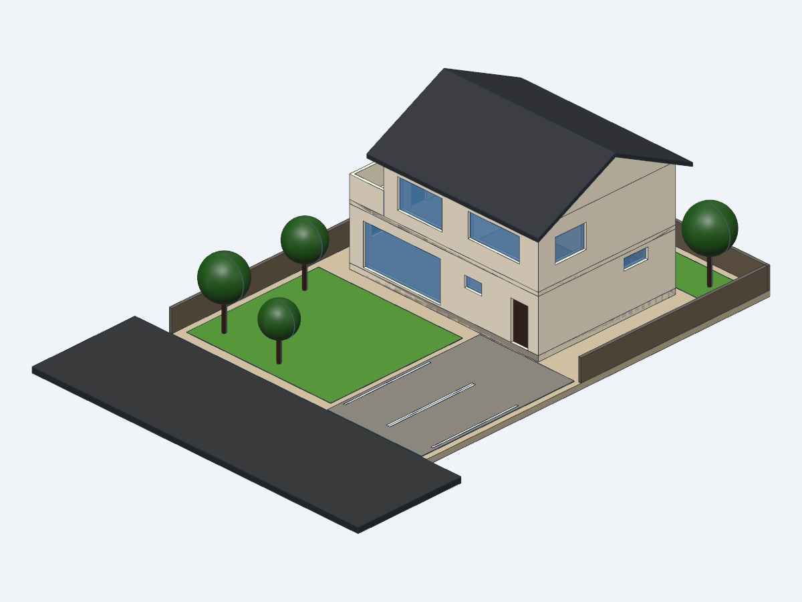
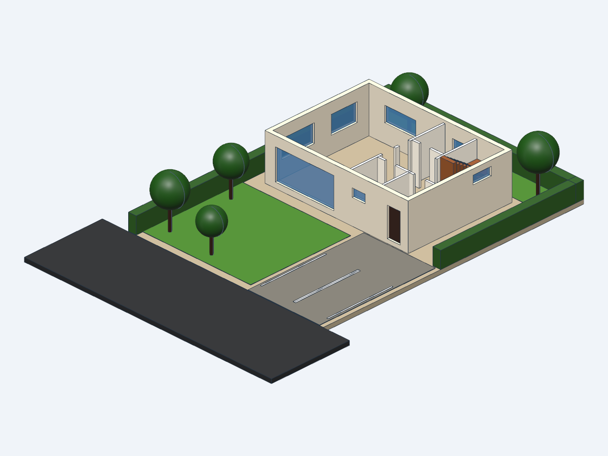
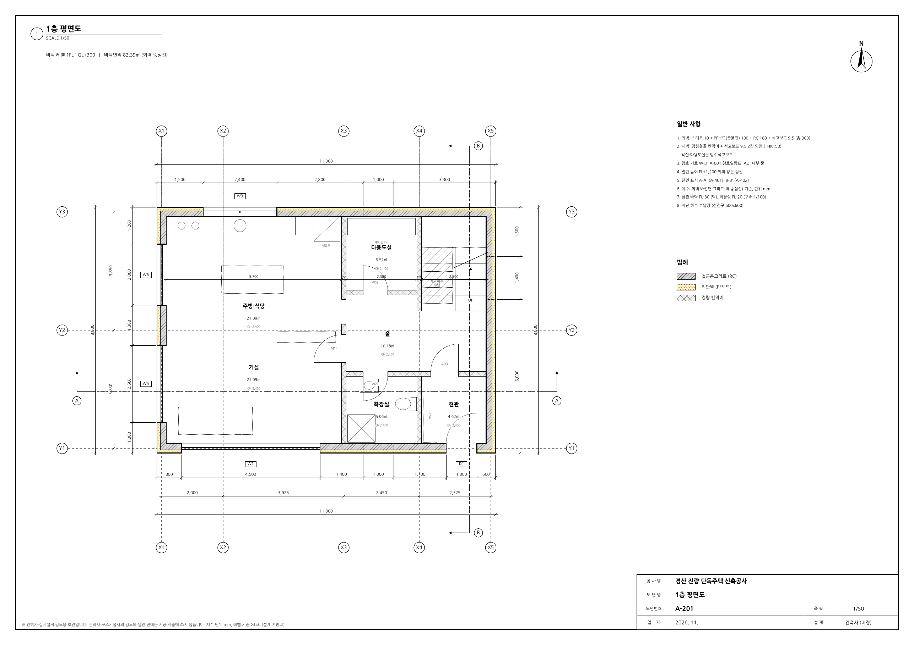
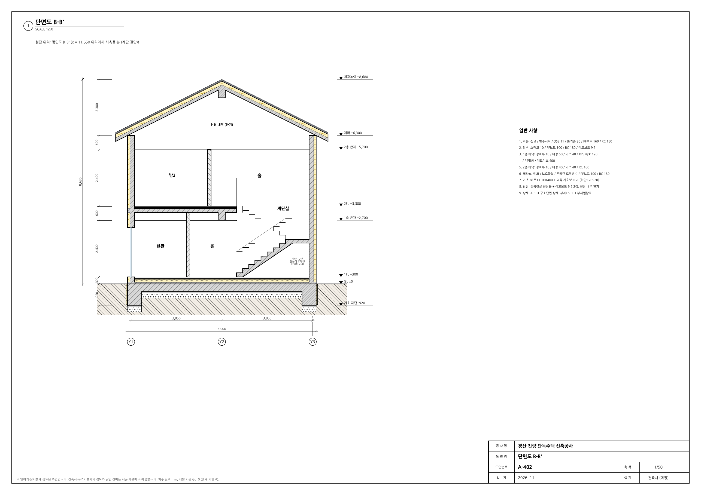

# 경산 진량 단독주택 (경산4일반산업단지 단독주택용지, 경일대 인근)

text-to-cad(build123d) 3D 모델과, 같은 설계값으로 만든 인허가·실시설계 수준의 도면 세트입니다.

| 외관 | 1층 (지붕·2층 숨김) |
| --- | --- |
|  |  |
|  |  |

## 파일

| 파일 | 내용 |
| --- | --- |
| `spec.py` | 설계값 한 곳: 대지, 벽·바닥·지붕 구성, 개구부, 내벽·문, 실, 마감, 구조부재, 면적 |
| `house.py` | 3D 모델 (`cad run house.py`) |
| `check.py` | 법규 검토 표 (`python3 check.py`) |
| `drawings.py` | 도면 PDF 생성 (`uv run drawings.py`) |
| `drawings/house_drawings.pdf` | A2 도면 15장 |
| `drawings_a3.py` | 경일대 건축학부 A3 양식(`templates/kiu_a3_frame.pdf`)에 도면을 앉힘 (`uv run drawings_a3.py`) |
| `drawings/house_drawings_A3.pdf` | A3 양식 도면 14장 (작성: 연제욱 20202672) |
| `exports/house.glb`, `exports/house.step` | 3D 파일 (웹 뷰어 / CAD) |

설계값을 `spec.py`에서 바꾸고 세 스크립트를 다시 돌리면 3D·도면·법규 검토가 함께 바뀝니다.

## 도면 목록

| 번호 | 도면명 | 축척 |
| --- | --- | --- |
| A-000 | 표지·건축개요·법규검토 | - |
| A-001 | 면적표·창호일람표·실내재료마감표 | - |
| A-101 | 배치도 (설비 인입 포함) | 1/100 |
| A-201 / A-202 | 1층 / 2층 평면도 | 1/50 |
| A-203 | 지붕 평면도 | 1/50 |
| A-301 ~ A-304 | 남·북·동·서 입면도 | 1/50 |
| A-401 / A-402 | 단면도 A-A' (가로) / B-B' (계단) | 1/50 |
| A-501 | 구조단면 상세 (기초, 2층 바닥, 처마, 테라스) | 1/20 |
| S-001 | 구조 일반사항·부재일람표·하중표 | - |
| S-101 | 기초·2층 바닥·지붕 구조평면도 | 1/100 |

## 대지

- 경상북도 경산시 진량읍 신제리·다문리 일원, 경산4일반산업단지 단독주택용지
- 제1종일반주거지역, 건폐율 60 % 이하, 용적률 180 % 이하, 3층 이하 (공개 자료 기준)
- 필지 번호는 **미확정**입니다. 대지는 평균 필지 14.5 m × 20 m = 290 ㎡, 남측 6 m 도로로 가정했습니다.

## 건물 개요

- 철근콘크리트 벽식구조 (보 G1·B1·TG1·RB1), 박공지붕 물매 5/10, 지상 2층, 최고높이 8.68 m
- 바닥면적 (외벽 중심선): 1층 82.39 ㎡, 2층 66.99 ㎡, 연면적 149.38 ㎡
- 1층: 거실, 주방·식당, 화장실, 현관, 다용도실, 계단 / 2층: 안방, 드레스룸, 욕실, 방2, 홀, 테라스
- 외벽: 스터코 / PF보드 100 (준불연 외단열) / RC 180 / 석고보드, 지붕: 싱글 / PF보드 160 / RC 150
- 기초: 매트 400 + 외곽 기초보 (하단 GL-920)

## 법규 검토 (`check.py`)

| 항목 | 계획 | 기준 |
| --- | --- | --- |
| 건폐율 | 28.41 % | 60 % 이하 |
| 용적률 | 51.51 % | 180 % 이하 |
| 층수·높이 | 2층, 8.68 m | 3층 이하 |
| 정북 일조 | 북측 3.0 m | 1.5 m 이상 |
| 주차 | 2대 | 1대 (연면적 150 ㎡ 이하) |
| 조경 | 87.9 ㎡ (30 %) | 조례 기준 |
| 계단 | 단높이 176.5 / 단너비 260 / 너비 1,000 mm | 200 이하 / 240 이상 / 600 이상 |
| 난간 | 1,200 mm | 1,200 mm 이상 |
| 내진 | 2층 → 구조안전 확인 대상 | 내진설계 적용 |
| 담장 | 생울타리 H1,200 | 1.2 m 이하 투시형·생울타리 (산단 지침) |
| 건축한계선 | 소로 전면, 도로에서 9.0 m | 대로 2 m / 중로 1 m (산단 지침) |

## 한계

이 도서는 **초안**입니다. 실제 인허가·시공 전에 다음이 필요합니다.

- 필지 확정, 지적측량·현황측량, 토지이용계획확인원과 지구단위계획 결정도서 확인
- 건축사의 설계·날인, 구조계산서 (부재 크기·배근은 예비 산정값), 지반조사
- 에너지절약계획서 (계획 열관류율은 표지에 계산값), 설비·전기·소방 도면

## 다시 만들기

```bash
cad run house.py
python3 check.py
uv run drawings.py
uv run drawings_a3.py
```
